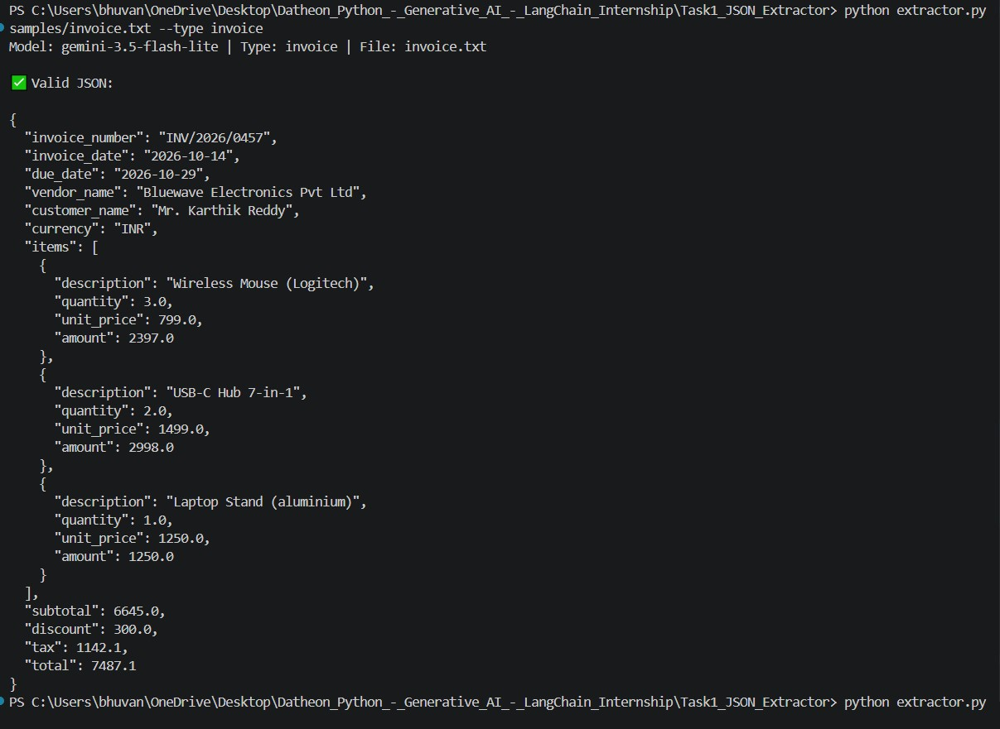
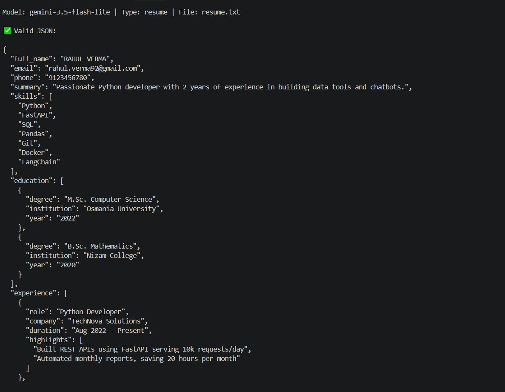
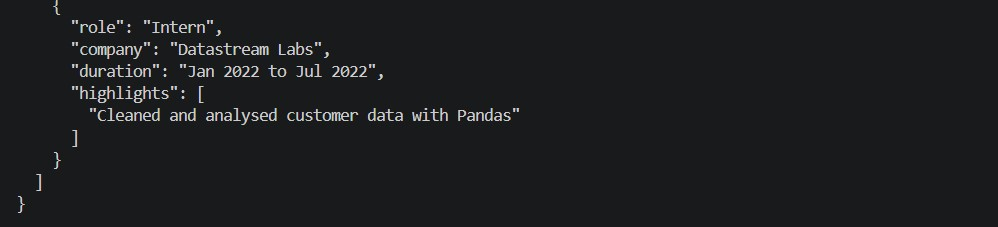

# Task 1: Structured LLM Prompt Pipeline & JSON Extractor

A Python script that turns **unstructured text** (invoices, resumes) into **strictly validated JSON** using Google Gemini, LangChain and Pydantic.

## How it works
1. **Prompt template** (`prompts.py`): fills in the task, the JSON schema, few-shot examples and the new document.
2. **LLM call** (`extractor.py`): sends the prompt to Gemini (temperature 0 for consistent output).
3. **Validation** (`schemas.py`): the reply is parsed and checked with Pydantic (types, date format `YYYY-MM-DD`, `total = subtotal - discount + tax`, email format).
4. **Auto-retry**: if validation fails, the error message is sent back to the model so it can fix its answer (max 3 attempts).

## Folder structure
```
Task1_JSON_Extractor/
├── extractor.py      # main script (CLI)
├── schemas.py        # Pydantic models: Invoice, Resume
├── prompts.py        # prompt templates + few-shot examples
├── samples/          # messy example documents
│   ├── invoice.txt
│   └── resume.txt
├── output/           # saved JSON results (--save)
└── requirements.txt
```

## Setup
```bash
pip install -r requirements.txt
```
Create a `.env` file (copy `.env.example`) and add your key from https://aistudio.google.com/apikey:
```
GOOGLE_API_KEY=your_key_here
```

## Run
```bash
python extractor.py samples/invoice.txt --type invoice
python extractor.py samples/resume.txt --type resume --save
```
Options: `--model <gemini-model-name>` to change the model, `--save` to write the result to `output/`.

## Example output (invoice)
```json
{
  "invoice_number": "INV/2026/0457",
  "invoice_date": "2026-10-14",
  "due_date": "2026-10-29",
  "vendor_name": "Bluewave Electronics Pvt Ltd",
  "customer_name": "Karthik Reddy",
  "currency": "INR",
  "items": [ "..." ],
  "subtotal": 6645.0,
  "discount": 300.0,
  "tax": 1142.1,
  "total": 7487.1
}
```
_Replace this with your real output and add a screenshot of the terminal below._

## Screenshots 📸 Project Output





## Tech stack
Python 3, Google Gemini (langchain-google-genai), Pydantic v2