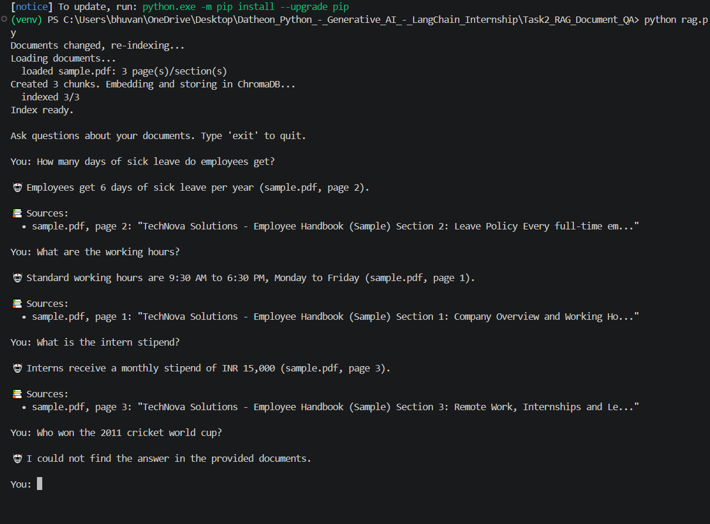

# Task 2: Document Q&A Assistant with RAG & Vector Embeddings

A Retrieval-Augmented Generation (RAG) system that answers questions **strictly from your own PDF/text documents** and cites the **source file and page number**.

## How it works
1. **Load**: LangChain `PyPDFLoader` reads each PDF page by page (`TextLoader` for .txt/.md).
2. **Chunk**: `RecursiveCharacterTextSplitter` (1000 characters, 200 overlap). Page metadata is kept on every chunk.
3. **Embed + store**: Gemini embeddings (`gemini-embedding-001`) are saved in a **ChromaDB** vector store (`chroma_db/`).
4. **Retrieve**: the 4 chunks most similar to the question are fetched.
5. **Answer**: Gemini answers using ONLY those chunks. If the answer is not in the documents it says so, instead of guessing.
6. **Cite**: the answer prints the source file and page numbers.

The index is saved on disk and rebuilt automatically when files in `data/` change.

## Folder structure
```
Task2_RAG_Document_QA/
├── rag.py              # complete RAG pipeline (CLI)
├── data/
│   └── sample.pdf      # sample document (put your own PDFs here)
├── chroma_db/          # auto-created vector store (not pushed to GitHub)
├── requirements.txt
└── .env.example
```

## Setup
```bash
# 1. Go to this task folder (from the repository root)
cd Task2_RAG_Document_QA

# 2. Create a virtual environment
python -m venv venv

# 3. Activate it
venv\Scripts\activate          # Windows
source venv/bin/activate       # Mac/Linux

# 4. Install dependencies
pip install -r requirements.txt
```
Add your key to a `.env` file (this folder or any parent folder):
```
GOOGLE_API_KEY=your_key_here
```

## Run
```bash
python rag.py                                   # interactive Q&A
python rag.py -q "How many sick leaves do I get?"   # single question
python rag.py --rebuild                         # force re-indexing
python rag.py --data my_pdfs                    # use another folder
```

## Example (sample.pdf)
```
You: How many days of sick leave do employees get?

🤖 Employees get 6 days of sick leave per year (sample.pdf, page 2).

📚 Sources:
  • sample.pdf, page 2: "Every full-time employee receives 18 days of paid leave..."

You: Who won the 2011 cricket world cup?

🤖 I could not find the answer in the provided documents.
```
_Replace with your real output and add screenshots below._

## Screenshots 📸 Project Output



## Tech stack
Python 3, LangChain, ChromaDB, Google Gemini (chat + embeddings), PyPDF