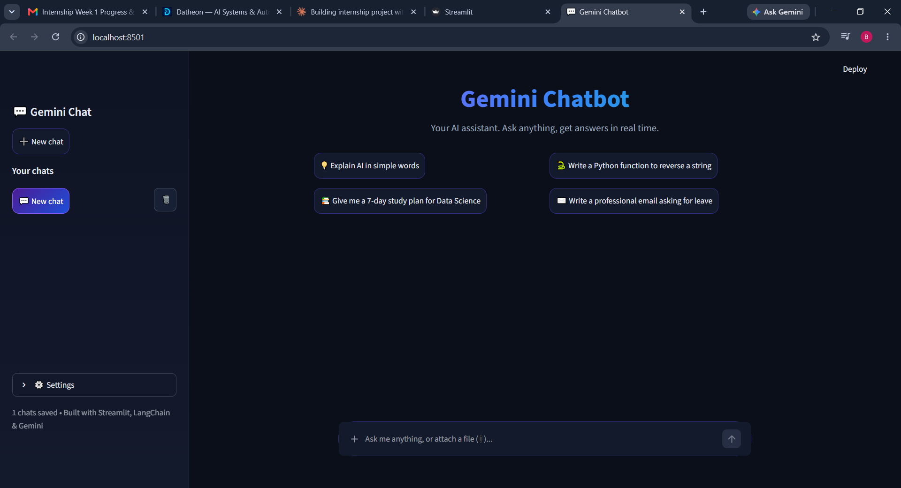
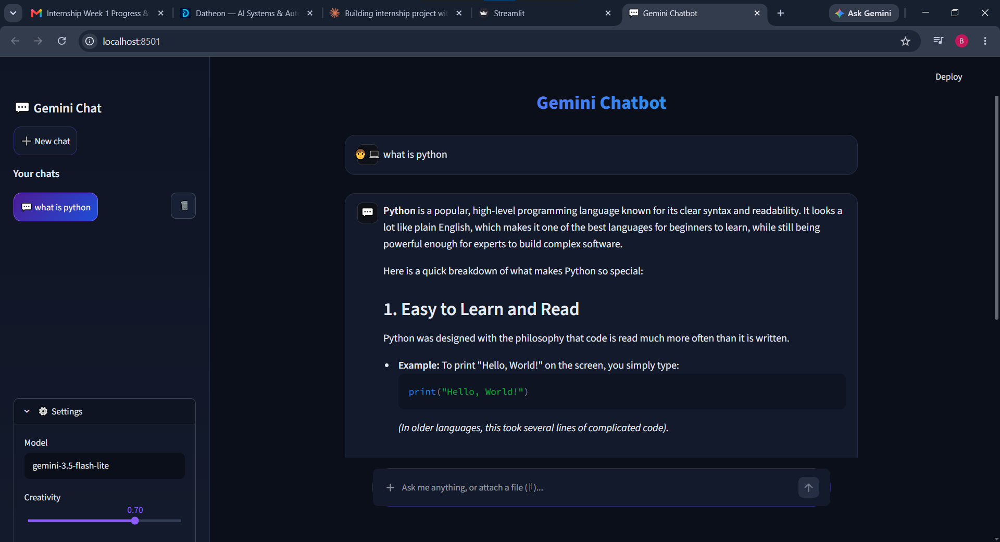

# Task 4: Interactive Full-Stack AI Chatbot with Streamlit

A web chatbot built with **Streamlit**, **LangChain** and **Google Gemini**. It streams replies token by token, remembers the conversation, keeps multiple saved chats, and can answer questions about uploaded images, PDFs and documents.

## Features
- **Streaming replies**: the answer appears token by token in real time
- **Conversation memory**: recent messages of the current chat are sent to Gemini on every turn
- **Session state management**: chat history kept in `st.session_state` so it survives Streamlit reruns
- **Multiple chats**: ➕ New chat button, a sidebar list of old chats, switch between chats, delete a chat
- **Saved history**: chats are stored in `chats.json`, so they are still there after restarting the app
- **File upload (📎)**: attach images (png, jpg, jpeg, webp) and documents (pdf, docx, txt, md, csv, json, py), then ask questions about them
- **Welcome screen** with suggested questions, dark theme, custom styling
- **Settings**: model name, creativity (temperature) and a Fast mode toggle
- **Error handling**: missing API key, empty replies, API errors

## How it works
1. `st.chat_input` takes the message (and attached files). `st.chat_message` shows the conversation.
2. All chats live in `st.session_state.chats` and are written to `chats.json` after every reply.
3. The last 10 messages are sent to Gemini on each turn, which gives it memory. Text extracted from uploaded documents is added to the system prompt, and images are sent directly to Gemini.
4. LangChain's `.stream()` yields the reply in pieces and `st.write_stream` shows them live.

## Folder structure
```
Task4_Streamlit_Chatbot/
├── app.py                  # the whole Streamlit app
├── requirements.txt
├── .env.example
├── .streamlit/
│   └── config.toml         # dark theme colors
├── chats.json              # auto-created, saved chats (not pushed to GitHub)
└── uploads/                # auto-created, uploaded images (not pushed to GitHub)
```

## Setup
```bash
# 1. Go to this task folder (from the repository root)
cd Task4_Streamlit_Chatbot

# 2. Create a virtual environment
python -m venv venv

# 3. Activate it
venv\Scripts\activate          # Windows
source venv/bin/activate       # Mac/Linux

# 4. Install dependencies
pip install -r requirements.txt
```
Add your key to a `.env` file (this folder or any parent folder):
```
GOOGLE_API_KEY=your_key_here
```
Get a free key at https://aistudio.google.com/apikey

## Run
```bash
python -m streamlit run app.py
```
Open http://localhost:8501 in your browser.

## Notes
- Model names change often. If you get a "model not found" error, change the **Model** field in the sidebar settings (default: `gemini-3.5-flash-lite`).
- Scanned PDFs (photos of pages) contain no text, so they cannot be read.
- On Streamlit Cloud, `chats.json` is shared by all visitors and can reset, so it is best for demos.

## Screenshots 📸 Project Output




## Tech stack
Python 3, Streamlit, LangChain, Google Gemini, PyPDF, python-docx